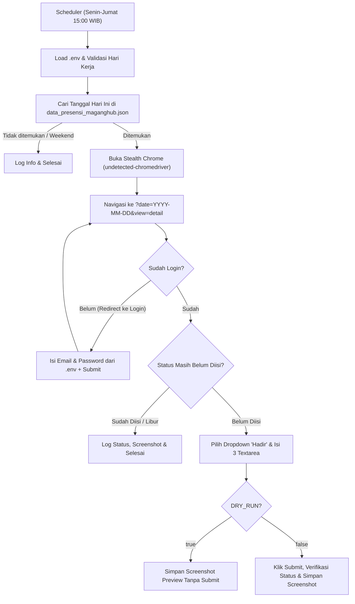

# Implementation Plan: Automasi Presensi MagangHub Kemnaker

## Goal Description
Membangun layanan automasi presensi harian untuk portal **Monev MagangHub Kemnaker** (`https://monev.maganghub.kemnaker.go.id/dashboard/riwayat?date=YYYY-MM-DD&view=detail`) menggunakan **Python** dan **Selenium** dengan teknik anti-deteksi (`undetected-chromedriver` + persistent Chrome profile + perilaku human-like).

Script akan membaca data kegiatan harian dari [data_presensi_maganghub.json](file:///home/azhar-fakhri/Documents/python/automasi_presensi_maganghub/data_presensi_maganghub.json), mencocokkan tanggal hari ini dalam format Indonesia (contoh: `"Jumat, 27 November 2026"`), memilih status kehadiran **`Hadir`**, mengisi 3 field form (**Uraian Aktivitas**, **Pembelajaran yang Diperoleh**, **Kendala yang Dialami**), lalu mengirimkannya secara terjadwal setiap **Senin–Jumat pukul 15:00 WIB** di homelab dengan kredensial login dari `.env`.

---

## User Review Required

> [!IMPORTANT]
> **Inspeksi Selector DOM Terautentikasi**: Portal `monev.maganghub.kemnaker.go.id` merupakan aplikasi SPA yang memerlukan login Kemnaker (SIAP/SSO) untuk membuka halaman form presensi. Karena kredensial tidak tersedia saat perencanaan, seluruh selector form akan dirancang secara modular di `src/selectors.py` menggunakan strategi pencocokan berbasis teks label (misalnya label `Kehadiran`, `Uraian Aktivitas`, `Pembelajaran yang Diperoleh`, `Kendala yang Dialami`) beserta fallback-nya, serta dilengkapi mode `DRY_RUN=true` dan tangkapan layar debug (`logs/screenshots/`) agar mudah diverifikasi/disesuaikan saat uji coba pertama dengan akun Anda.

> [!NOTE]
> **Persistent Chrome Profile & Anti-Deteksi**: Penggunaan `CHROME_PROFILE_DIR` memungkinkan cookie sesi login tersimpan antar eksekusi. Ini sangat mengurangi frekuensi login ulang (yang berisiko memicu proteksi bot/CAPTCHA di halaman SSO Kemnaker).

---

## Proposed Architecture



---

## Proposed Changes

### 1. Project Configuration & Dependencies
#### [NEW] `requirements.txt`
Menambahkan dependensi Python (kompatibel dengan Python 3.14):
- `selenium`
- `undetected-chromedriver`
- `setuptools` (diperlukan `undetected-chromedriver` pada Python 3.12+)
- `python-dotenv`
- `APScheduler`

#### [NEW] `.env.example`
Template konfigurasi environment:
```env
KEMNAKER_EMAIL=email_anda@example.com
KEMNAKER_PASSWORD=password_anda

BASE_URL=https://monev.maganghub.kemnaker.go.id/dashboard/riwayat
DATA_FILE=data_presensi_maganghub.json
CHROME_PROFILE_DIR=./chrome_profile

HEADLESS=true
DRY_RUN=true
TIMEZONE=Asia/Jakarta
SCHEDULE_HOUR=15
SCHEDULE_MINUTE=0
```

#### [NEW] `.gitignore`
Mengabaikan `.env`, `chrome_profile/`, `logs/`, `__pycache__/`, dan `.venv/`.

---

### 2. Core Modules (`src/`)

#### [NEW] `src/config.py`
Memuat dan memvalidasi seluruh variabel dari `.env` ke dataclass `AppConfig`.

#### [NEW] `src/data_loader.py`
- Mengonversi tanggal `datetime.date` ke format key JSON Indonesia (contoh: `2026-11-27` -> `"Jumat, 27 November 2026"`) tanpa bergantung pada OS locale `id_ID` (agar aman di server homelab/Docker minimal).
- Membaca `data_presensi_maganghub.json` dan memvalidasi keberadaan 3 field wajib:
  - `uraian aktivitas`
  - `pembelajaran yang diperoleh`
  - `kendala yang dialami`

#### [NEW] `src/browser.py`
- Inisialisasi `undetected_chromedriver.Chrome` dengan opsi anti-deteksi:
  - `--disable-blink-features=AutomationControlled`
  - `--user-data-dir` persisten (`CHROME_PROFILE_DIR`)
  - Window size realistis (`1366,768` atau `1920,1080`), bahasa `id-ID,id`, dan dukungan `--headless=new` bila `HEADLESS=true`.
- Helper interaksi manusiawi (`human_delay`, `human_type`, `safe_click` dengan scroll ke elemen).

#### [NEW] `src/selectors.py`
Definisi terpusat selector login, status presensi, dropdown `Hadir` (mendukung `<select>` standar maupun custom dropdown UI), 3 textarea form, dan tombol submit agar mudah diperbarui jika ada perubahan UI.

#### [NEW] `src/presensi_bot.py`
Orkestrator alur presensi:
1. Membuka URL `BASE_URL?date={YYYY-MM-DD}&view=detail`.
2. Mendeteksi jika diarahkan ke halaman login -> mengisi kredensial `.env` & submit.
3. Mengecek apakah presensi tanggal tersebut sudah terisi (`Menunggu Persetujuan` / `Hadir disetujui`) atau `Hari Libur`.
4. Memilih `Hadir` pada dropdown Kehadiran.
5. Mengisi 3 form teks sesuai data JSON.
6. Jika `DRY_RUN=true`, mengambil screenshot tanpa menekan Submit; jika `false`, menekan Submit, memverifikasi hasil, dan menyimpan screenshot ke `logs/screenshots/`.

---

### 3. Entrypoints & Homelab Deployment

#### [NEW] `main.py`
CLI entrypoint dengan argumen:
- `--run-now`: Eksekusi sekali langsung (cocok untuk cron/testing).
- `--date YYYY-MM-DD`: Menentukan tanggal target secara manual (default: hari ini WIB).
- `--dry-run`: Override `DRY_RUN=true` untuk simulasi aman.

#### [NEW] `scheduler.py`
Service scheduler menggunakan `APScheduler` (`CronTrigger(day_of_week="mon-fri", hour=15, minute=0, timezone="Asia/Jakarta")`) yang berjalan terus-menerus sebagai daemon di homelab.

#### [NEW] `deploy/presensi.service`
Contoh unit file `systemd` untuk menjalankan `scheduler.py` di homelab Linux.

#### [NEW] `Dockerfile` & `docker-compose.yml`
Konfigurasi container siap pakai dengan Google Chrome + `xvfb` (virtual display agar Chrome bisa berjalan non-headless di homelab untuk tingkat stealth maksimal), volume mount untuk `.env`, `data_presensi_maganghub.json`, `chrome_profile/`, dan `logs/`.

#### [NEW] `README.md`
Panduan setup `.env`, uji coba `--dry-run`, dan deployment di homelab (systemd / Docker).

---

## Verification Plan

### Automated Tests
- Membuat unit test ringan (`tests/test_data_loader.py`) untuk memverifikasi konversi tanggal ke format key JSON Indonesia (termasuk hari kerja, akhir pekan, dan seluruh 10 entri pada `data_presensi_maganghub.json`):
  ```bash
  python3 -m unittest discover -s tests -v
  ```
- Verifikasi import modul, parsing `.env`, dan dry-run CLI help:
  ```bash
  python3 main.py --help
  ```

### Manual Verification
1. Salin `.env.example` menjadi `.env` dan isi `KEMNAKER_EMAIL` serta `KEMNAKER_PASSWORD`.
2. Jalankan uji coba aman tanpa submit terlebih dahulu untuk tanggal yang ada di JSON:
   ```bash
   python3 main.py --run-now --date 2026-11-27 --dry-run
   ```
3. Periksa screenshot di `logs/screenshots/` untuk memastikan login berhasil, dropdown `Hadir` terpilih, dan 3 form terisi sesuai JSON.
4. Setelah yakin sesuai, set `DRY_RUN=false` di `.env` dan aktifkan service `scheduler.py` (via `systemd` atau `docker compose up -d`).
